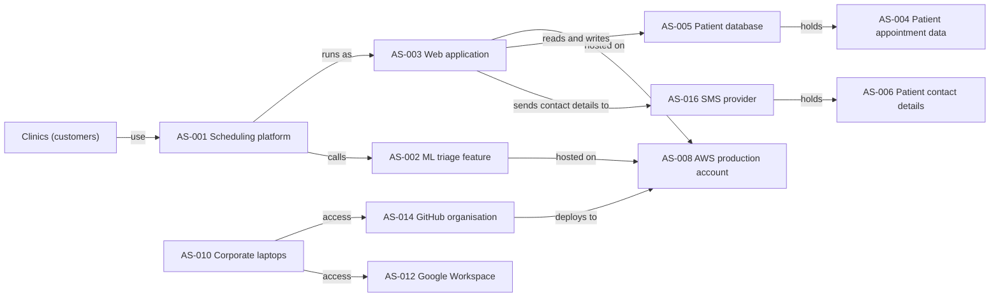

# CMDB relationships: Northbridge Health Ltd

How the main assets connect (service, application, data, supplier).

## Reading it
- If AWS production goes down, the scheduling platform, web app and ML feature all go down (R-003).
- If the SMS provider is breached, patient contact details are exposed (R-006).
- If a laptop is lost, the paths to GitHub and Google Workspace are exposed (R-009, R-002).

## Honest limits
- No active backup or failover plan