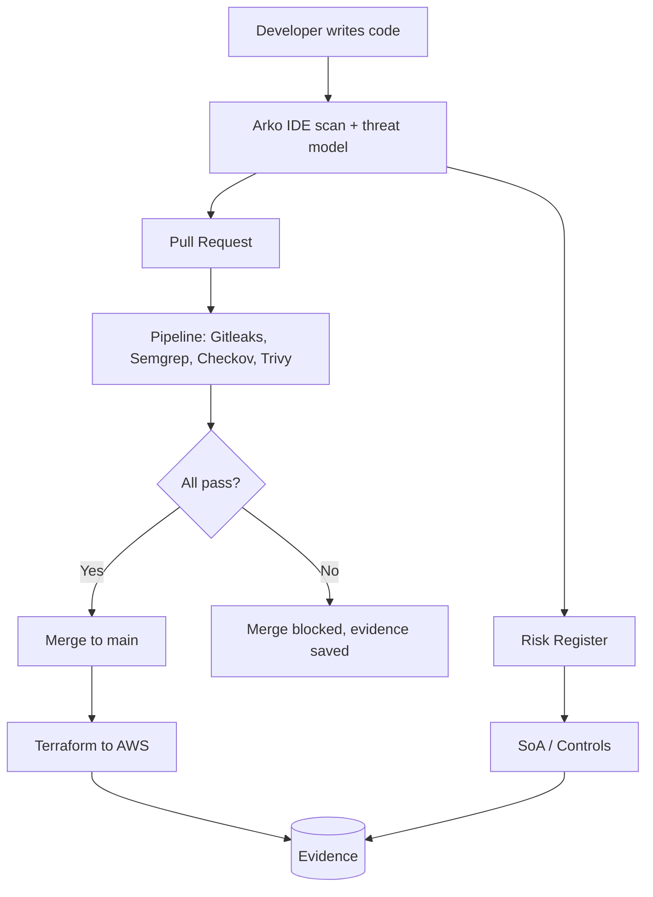

# Northbridge Health Ltd: GRC Portfolio

A hands-on Governance, Risk and Compliance (GRC) lab built around one **fictional** company.
It shows how risk, controls, cloud infrastructure, security automation and evidence connect.

> **This is a lab project.** Northbridge Health Ltd is fictional. No real data or real systems are used.

## 1. Business context
Northbridge Health Ltd is a 60-person UK SaaS company that provides patient appointment scheduling to clinics.
It runs on AWS and has one machine-learning feature that helps triage appointment requests.
See [company profile](01-governance/company-profile.md).

## 2. Why these frameworks apply
| Framework | Why Northbridge needs it |
|---|---|
| ISO/IEC 27001:2022 | UK/EU tenders ask for an Information Security Management System |
| SOC 2 | US and enterprise customers ask for it |
| NIST CSF 2.0 | Common language for risk and control maturity |
| UK GDPR | Northbridge handles patient-related personal data |
| EU AI Act | The ML triage feature may be regulated |
| MITRE ATT&CK | Links threats to detections and controls |

## 3. Scope
See [ISMS scope](01-governance/isms-scope.md).

## 4. Repository map
| Folder | Contents |
|---|---|
| `01-governance/` | Company profile, ISMS scope, policies, 3 Lines of Defence |
| `02-risk/` | Risk methodology and risk register |
| `03-compliance/` | Statement of Applicability, control crosswalk |
| `04-tprm/` | Vendor inventory, tiering and assessments |
| `05-asset-cmdb/` | Asset register and CMDB design |
| `06-infrastructure/` | Terraform modules for AWS |
| `07-detection/` | SIEM detections mapped to ATT&CK |
| `08-ai-governance/` | EU AI Act classification, AI inventory |
| `docs/` | Glossaries and toolchain notes |
| `evidence/` | Scan outputs and screenshots used as audit evidence |
| `.github/workflows/` | Security pipeline |

## 5. Architecture (placeholder, update as you build)

## 6. How to reproduce
_Fill in as you build: tools, versions, commands._

## 7. Control mapping
_Fill in from Day 21: tool or step, ISO 27001:2022 control, NIST CSF 2.0 reference._

## 8. Risk summary
_Fill in from Day 4 and Day 21._

## 9. Lessons learned
_Fill in at the end._

## 10. What I would do differently
_Fill in at the end._

## Frameworks used
NIST CSF 2.0 | ISO/IEC 27001:2022 | SOC 2 | MITRE ATT&CK | EU AI Act | UK GDPR
